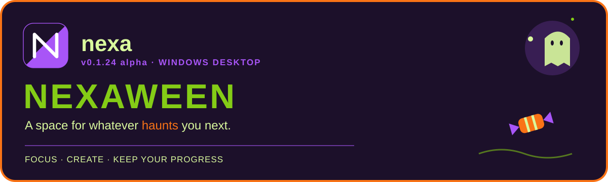

# Changelog

## 0.0.34 Alpha — Interface Refinement, Data Safety & Installer Repair

- Refine Home branding, independent backgrounds, official palettes, nexaween toggle, settings scrolling/sounds and permanent Pixel Timer controls.
- Keep complete content visible during session handoffs. Physical flicker acceptance remains open and blocks Beta.
- Add larger circular communal webs, one authoritative behavior selector and fresh transient ecosystems while retaining permanent history and scores.
- Redesign Profile around actual recorded activity and durable completed-session identities; preserve onboarding answers and genuine Hedy/Hevy provider identities.
- Consolidate private saves under LocalAppData/Nexa using verified legacy copies and preserved originals. Add sanitized ZIP backup and explicitly confirmed local reset with a durable no-reimport guard.
- Simplify approved-release discovery; add verified Rerun Installer, bounded discovery, repair, independent shortcuts, integrity checks and rollback. Wait for Inno cleanup before retrying an installation.
- Verified: 26 routes / 1,202 assertions, 75 native data/UI, 40 installer lifecycle, 32 upgrade/migration and 17 packaged checks. Physical trackpad/mixed-DPI/wizard acceptance remains open; packages are unsigned.

## 0.0.33 Alpha — Windows Installer, Release Integrity & Appearance Finalization

- Add a current-user Windows installer with Installed Apps registration, Start menu and optional desktop shortcuts, repair and data-preserving uninstall. Removing private data requires explicit confirmation.
- Deliver the same application in installer and portable formats, retaining updates in both. Installed updates run verified Setup with registration-aware rollback. Older compatible updaters receive an installer migration launcher; legacy .24/.26 comparison may require a one-time manual install.
- Back up verified old portable copies and existing private saves before optional cleanup; preserve unrelated files and unverified executables. Add Files & sharing and readable history documents under Documents → nexa.
- Hide only the Appearance scrollbar while retaining complete scrolling. Expose exactly nexa, Violet, Aurora and Ember, with independent Classic/seasonal colors and wallpapers and the seasonal override message.
- Preserve laptop bounds, game/audio, batched saves, accounts, history and update countdown controls.

## 0.0.32 Alpha — Appearance Restoration & Scrolling Refinement (local, unpublished)

- Restore complete Appearance scrolling, visible draggable scrollbars and Theme Colors in Classic and nexaween.
- Retain existing saved global themes; expose recovered Blue/Green/Amber/Violet palette swatches through the existing Home/Space background model. See the .32 audit for the distinction between historical session palettes and wallpaper presets.
- Apply independent wallpaper previews immediately; share image decoding/cache, preserve fit/fill and blur, retain unavailable-file choices and restore native file-picker foreground ownership.
- Unify proportional wheel handling with Windows line/page settings, fine-delta accumulation and inner-first boundary handoff; preserve native keys, scrollbar dragging and focused selector stepping. Physical precision-trackpad acceptance remains open.
- Preserve the latest laptop bounds, stationary Home logo, fatal-shot fix, batched kill persistence, independent audio and automatic-update flow. No release or push authorized.

## 0.0.31 Alpha — nexaween: Interface Polish & Release Integrity (2026-10-28)

- Centralize canonical release identities; explicitly map confirmed legacy Alpha records while retaining genuine Beta numbering and legacy asset provenance.
- Improve update eligibility/error reporting and persisted channel selection. Older published comparators require a one-time verified portable bridge; legacy downloads and asset identities remain intact.
- Center Recent Space titles independently of larger left icons; add a preview/save/cancel Space icon grid and cap-and-gown option in Session Settings.
- Keep the approved pumpkin and Home-only candlelight; improve Home header alignment, wrap Pixel Timer status, and place Test Sound directly below Sound Style.
- Refine rounded eight-legged spiders and progressive orb silk. Explicit session loads reset live activity using a persistent generation marker, preserving permanent data and ordinary crash recovery.
- Google/Microsoft account integration work is deferred by direct user request; existing integrations remain intact.

Historical Alpha heading numbers below are canonicalized. Original release URLs, filenames and historical implementation reports retain legacy identifiers where needed for compatibility and provenance; see docs/NEXA_031_VERSION_MIGRATION.md.

## 0.0.30 Alpha — NEXAWEEN: Final Refinement (local, unpublished)

- Share one transparent painterly pumpkin asset across Home and seasonal decorations, with larger Home art, attached dark green curls and gentle candlelight.
- Capture bug clicks through release using species-shaped expanded regions; keep widgets usable outside hits. Move fatal-click durable writes to background tasks while retaining event replay and duplicate-award protection.
- Preserve fullscreen through Home and Space navigation, restore original window bounds, and use recognizable vector caption controls.
- Restore the Classic splash tagline, remove the seasonal loading bar, and show compact standalone previews without changing their host.
- Add a bounded decorative Home spider with wandering, pauses, grooming and physically collected candy; honor seasonal, animation and reduced-motion preferences.
- Preserve .29 session/history/autosave, provider, notification spacing and Space icon-order behavior. Physical hardware and subjective visual acceptance remain open.

## 0.0.29 Alpha — NEXAWEEN: Final Polish & Workspace Evolution (unpublished)

- Archive original completed session data before resetting; preserve tasks, configuration, recordings, all-time statistics and the existing recap.
- Compact native fullscreen with overlay notification, persisted shortcuts and optional Windows battery/network/default-output volume controls.
- Independent Home/Space wallpaper previews, fit/fill and defaults; embed timer configuration in Session Settings.
- Lowercase left-aligned version branding, five-second compact splash and permanent Classic executable icon.
- Larger Home titles with icons on the left and top-bar Space names followed by their icons. Live productivity breakdown, 0–20 distraction phrases, expandable real-content intervals and growing transcript regions.
- Explicit History resume/new choices, advanced-only legacy bug modes, click-only health bars, white orb/corner silk and intermittent Home spider motion.
- Released as an explicitly marked Nexaween Alpha prerelease. Physical Windows, hardware, live providers and extended-session acceptance remain open; this is not Beta acceptance.

## 0.0.28 Alpha — NEXAWEEN EVOLVED (2026-10-28, unpublished)

- Reuse lazy body construction for all widgets in large Spaces; keep saved
  models and create real editors when they enter the viewport. Navigation
  profiling now includes source teardown, layout and dispatcher idle.
- Guard postponed-reset completion against repeated/stale invocation so a
  newly active session cannot be archived prematurely.
- Restore selectable Creepy AI alongside Classic, Cozy and Combative. Give
  attacked creatures immediate defensive orders in Combative mode; retain
  existing species damage values and world identities.
- Add capped 20-second direct-squash Bug Frenzy. The existing two-minute shared
  candy/squash streak is preserved; bonuses use the greater eligible multiplier
  and never multiply each other. Duplicate/delayed events cannot extend it.
- Preserve the approved icon/X and animation defaults. Extend disposable
  process-termination, recovery, scheduling and lazy-editor tests; record
  performance and outstanding Beta acceptance in the .28 reports.

## 0.0.27 Alpha — NEXAWEEN (2026-10-28, unpublished)

- Adopt the stage convention v0.0.X Alpha, v0.1.X Beta, then v1.0.0 stable.
  Update current assembly/file/manifest metadata and shared visible labels.
- Compare legacy 0.1.X Alpha revisions safely against the new Alpha convention,
  retaining original release tags, asset URLs and Beta numbering.
- Add adjacent Adorable Mode / Advanced Animations controls, with advanced
  rendering opt-in by default; preserve the existing renderer and reduced motion.
- Separate costume choice from appearance and honor costume-off with explicitly
  selected Halloween appearance.
- Keep shared splash stages and preview with a minimum three-second display.
- Match the supplied seasonal icon geometry and exact orange palette; outline
  only the icon perimeter/hourglass silhouette. Keep wordmark letters borderless
  and use the requested classic white/light-orange X contrast. Export 16–1024px PNGs and a six-size Windows ICO.
- Preserve the completed October 28 handoff and document .28 carry-forward work.

Physical/live-account acceptance remains open; automated branding checks and
source-rendered previews are recorded in the .27 status.
No Alpha release, tag or existing approved binary is changed by this work.

## 0.0.26 alpha — Spaces in Motion (2026-10-28)

Additional **unpublished handoff candidate** work: full seasonal visibility/hit-testing restoration; compact golden-lightning Productivity; centered Space cards and paced/reverse expansion with working mouse-wheel scrolling; bottom-pinned Experimental Features; Chicago zone aliases and selection-only dropdown; new-Space viewport reset; five sound styles; tagline-first splash and in-place preview; safer transitions; cumulative scores and recap snapshots in private exports; illustrated recaps and guide polish. This does not describe the bytes already published under v0.1.26-alpha. See [handoff evidence and remaining acceptance](docs/HANDOFF-COMPLETION-0.1.26-alpha.md).

- Paired Create/Import actions, six initial Space cards, all/ six expansion controls and saved vector Space icons.
- Black-backed navigation transitions, dispatcher-safe failure recovery and off-thread Space/DEV file preparation.
- Existing DEV timers/layouts remain intact; Settings initializes pages on demand and groups experimental pages in an expander.
- Streamlined setup skips the redundant activity step and adds rounded name inputs, Space icons and a preference-preserving Nexaween toggle.
- Immediate splash-bar visibility with monotonic real milestones, visible version, no three-second hold, and frozen shared logo resources.
- Thirty-second tips with five-second display, more close-button spacing, compact flame-free streak feedback and restored normal beverage colors.

- Persistent cumulative productivity per Space, one-point collectible candy and a shared half-step streak multiplier.
- Circular animated Productivity widget, dedicated save-first End Session, one-second early-completion feedback and saved accomplishment/score recaps.
- Interactive dashboard spotlights for adding, moving, resizing and renaming widgets, with skip/replay and restart recovery.
- Optional Todoist/Hevy introduction, separate manual/schedule Pixel Timer drafts, independent theme/sound settings.
- Larger web-bound Home spider, rounded shaded jack-o-lanterns, stalk-connected earthy vines and scroll-stable widget pumpkins.

**Verification:** 507 regression checks, 10 native updater checks and packaged x64 startup passed. Physical mixed-DPI, genuine hibernation, live-provider and extended performance acceptance remain pending; a measured Space-loading latency outlier remains. See the [release notes](docs/releases/0.1.26-alpha.md).

## 0.0.25 alpha — dashboard refinements (development only)

- Gradual bug arrivals, shared spider silk, compact tips, larger squash illustrations, widget jack-o’-lanterns and scrolling feedback fixes.
- See [recorded verification and limitations](docs/TWEAKS-0.1.25.md).

## 0.0.24 Alpha — final-prompt repair candidate (not released)

- **The Archives Awaken:** catch historical validation failures, preserve damaged original records, protect unreadable files from fallback writes, and load/filter reports away from the UI thread with explicit dispatcher updates.
- **Time Is Under a Spell:** explicit Manual/Schedule editing, persisted preset mode and schedule-only Reset protection.
- **Spells of Convenience:** accessible single-window Appearance, a single top seasonal switch, session-only settings, transient save feedback, revised Home pagination, contextual Add Widget, sound previews, and monitor-aware notifications.
- **Creepy Crawlies:** overlay-only navigation, visible bugs without widget click interception, independent appearance/behavior, legacy mode migration, and bounded All Bugs rebalancing.
- **Productivity Witchcraft:** saved-event audio and no full-window green feedback from direct bug squashes.
- **The Dashboard Has Been Haunted:** the prior seasonal artwork remains; the final mixed backgrounds, large static corner scenes and growing vines are still pending.

This candidate is not the final Nexaween release. See [verification and outstanding acceptance](docs/FINAL-0.1.24-STATUS.md). No production release was overwritten.

## Previously published baseline — nexa 0.0.24 Alpha — NEXAWEEN

A space for whatever haunts you next.

- **The Dashboard Has Been Haunted:** resource-matched seasonal branding and tagline, candy-only backgrounds, contextual widget corners and curved vines.
- **Time Is Under a Spell:** authoritative elapsed session progress, reverse intersession clearing, linked/independent bars, recurring/date/duration editing, clock alignment and controlled selectors.
- **Creepy Crawlies:** Classic/Cozy/Creepy/Combative, automatic appearance, effective species/density controls, widget avoidance, flight and persistent spider-owned web construction.
- **Productivity Witchcraft:** central signed scoring, prominent score/multiplier, timestamp-based two-minute streaks, bounded half-step multipliers and saved-event perimeter feedback.
- State reads wait for an in-flight checkpoint, preventing transient file replacement from loading empty defaults.
- **The Archives Awaken:** retained searchable history, continuous saving, recovery and protected session resets.
- **Spells of Convenience:** consolidated Session/history/tips, unified Appearance, Sounds, pumpkin settings/toggle, genuine splash stages and split floating notifications.

See the [implementation report](docs/IMPLEMENTATION-0.1.24.md) for verification and remaining manual acceptance. Retired story source is archived, and the repository root has been audited against the current build.

[Download this Alpha release](https://github.com/scrmarsh/nexa/releases/tag/v0.1.24-alpha).

Older versions are preserved in the [historical changelog](LEGACY/notes/CHANGELOG-through-20261027.md).
