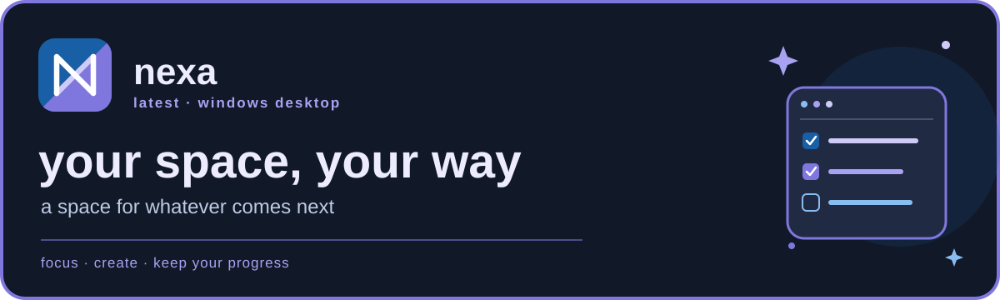
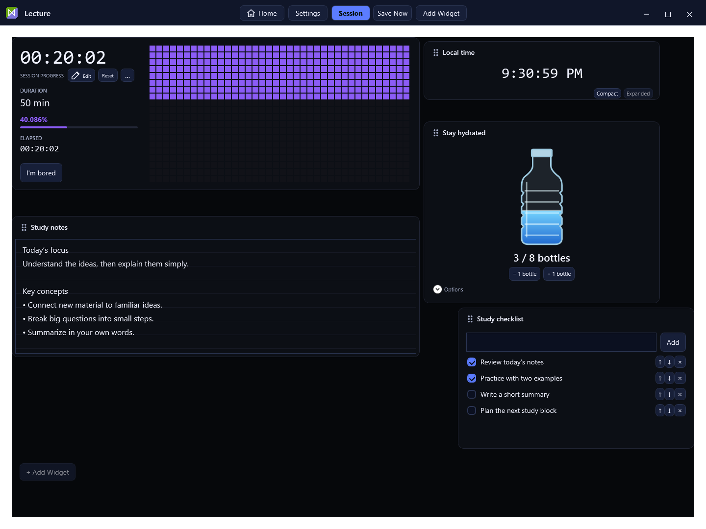
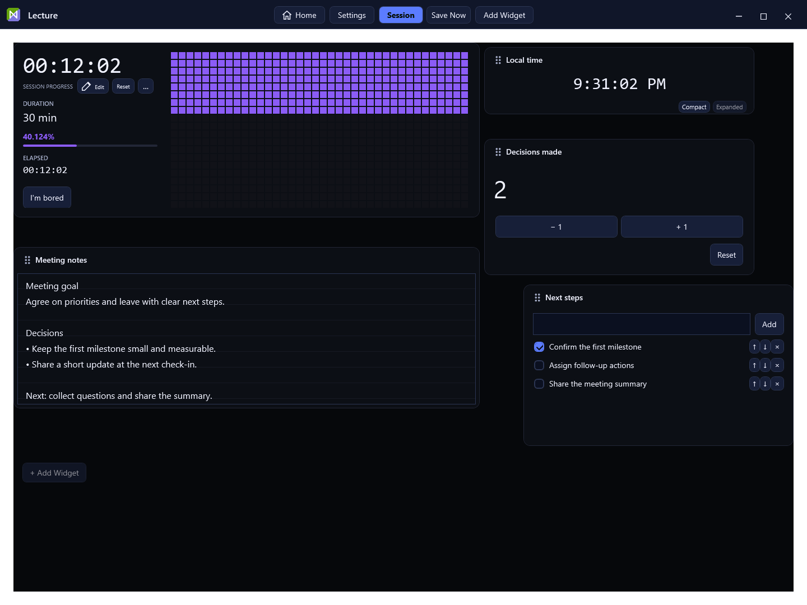

<div align="center">




**a space for whatever comes next**

[**Download nexa for Windows — installer**](https://github.com/scrmarsh/nexa/releases/download/v0.0.34-alpha/NexaSetup.exe) · [What's new](CHANGELOG.md) · [Build from source](#build-from-source) · [Development status](docs/NEXA_034_STATUS.md)

</div>

> **nexa v0.0.34 alpha — Interface Refinement, Data Safety & Installer Repair.** Refined Home and settings, cooperative webs, permanent Pixel Timer controls and recorded Profile activity. Verified migration, credential-free backup, confirmed reset and installer repair preserve your workspace. One app, with updates retained in both installed and portable use. [Installer and data guide](docs/NEXA_034_DATA_AND_INSTALLER.md) · [Verification](docs/NEXA_034_TEST_RESULTS.md).

<details>
<summary>Portable download, checksums, source and technical documentation</summary>

- [Portable nexa executable](https://github.com/scrmarsh/nexa/releases/download/v0.0.34-alpha/nexa-portable.exe) — the same application as the installer payload, with update support.
- [Checksums](https://github.com/scrmarsh/nexa/releases/download/v0.0.34-alpha/SHA256SUMS.txt) and [release notes](https://github.com/scrmarsh/nexa/releases/tag/v0.0.34-alpha).
- [Source code](https://github.com/scrmarsh/nexa/tree/v0.0.34-alpha), [installer audit](docs/NEXA_034_AUDIT.md), [appearance and implementation](docs/NEXA_034_STATUS.md), [historical release audit](docs/NEXA_033_RELEASE_CLEANUP.md).
- `Nexa.exe` on the release is a compatibility installer launcher for old updaters; use the installer above or the explicitly labeled portable download.

</details>

Alpha development now uses **v0.0.X Alpha**, Beta will use **v0.1.X Beta**, and
the first stable release is planned as **v1.0.0**. This nexaween build is an
explicitly marked Alpha prerelease; **v0.1.0 Beta** remains reserved for the first
approved Beta. Historical legacy-tag aliases and **0.0.26 — Spaces in
Motion** remain in the release history. Updater comparison recognizes legacy
Alpha revisions without changing their tags or download URLs.

Already-distributed older Alpha executables retain their original comparison
logic. Installing a newer approved build manually may be necessary to bootstrap
the corrected updater. The code cannot retrofit an old executable.


nexa is a local Windows productivity dashboard for classes, study, meetings and everyday work. Arrange movable widgets into a Space, follow your recurring sessions, and keep your notes, tasks and progress together.

## Dashboard examples

Real screenshots of the published Windows build, using sample notes and tasks. Select an image to view it at full size.

| Study space · dark | Meeting space · dark |
| --- | --- |
| [](docs/media/screenshots/study-space-dark.png) | [](docs/media/screenshots/meeting-space-dark.png) |

## Install for Windows

Close nexa before running Setup. Use the **[recommended Windows installer](https://github.com/scrmarsh/nexa/releases/download/v0.0.34-alpha/NexaSetup.exe)**. It preserves existing saves and adds normal Windows shortcuts, repair and uninstall. Portable and source downloads are in the collapsed section above. This is an Alpha prerelease; physical device and live-provider acceptance remains open.
Self-contained Windows x64 packages include their .NET runtime; framework-dependent
builds require the .NET 10 Desktop Runtime.

For a downloaded package with a published `SHA256SUMS.txt`, inspect its checksum:

```powershell
Get-FileHash .\NexaSetup.exe -Algorithm SHA256
```

Compare the result with `SHA256SUMS.txt`. Private data is consolidated under `%LocalAppData%\Nexa`. Verified migration copies preserve legacy saves and originals; conflicts are retained for review. See the [data guide](docs/NEXA_034_DATA_AND_INSTALLER.md). The repository and release downloads are public; no GitHub sign-in is needed.

## Inside your Space

| Make it useful | Make it yours |
| --- | --- |
| Recurring class schedules and a Pixel Timer that fills during class and counts down between sessions | Movable, resizable widgets with scrolling room below your layout |
| Notes, tasks, water tracking, counters, Scripture and recording/timeline tools | Configurable appearance, sounds and optional integrations |
| Session history, automatic checkpoints and save-before-reset protection | Combined Productivity view, score breakdowns and squash streaks |
| Time zone settings and precise linked or independent progress bars | Optional decorative bugs with independent behavior and appearance |

## What’s new

Release-specific features, seasonal artwork and update notes live in the [changelog](CHANGELOG.md). The [current verification report](docs/NEXA_034_TEST_RESULTS.md) records testing and known limitations.

## Build from source

Use Windows and the **.NET 10 SDK** with Windows desktop support:

```powershell
dotnet build .\SessionDashboard.csproj -c Release
.\bin\Release\net10.0-windows\Nexa.exe
```

`run.bat` provides the same build-and-launch workflow. To create a self-contained Windows x64 executable:

```powershell
.\Publish-Exe.ps1
# Use the output path printed by the script.
```

To build the installer, portable executable and legacy migration launcher together, run `.\tools\Build-Release.ps1`; outputs stay under `verification/release034` until approved. See the [installer build guide](docs/NEXA_034_DATA_AND_INSTALLER.md).

The historical project filename and save-data namespace remain for compatibility; the product is **nexa**.

## Verify and contribute

```powershell
.\tools\Verify.ps1
```

The 26-route suite checks version compatibility, installer-related models, appearance, settings, splash timing,
layout, scrolling, saving, history, controls, the ecosystem and animations using
isolated data stores. To run the .28 failure/recovery and behavior route after building the checks project:

```powershell
dotnet build .\tests\SessionDashboard.Checks.csproj -c Release
.\tests\bin\Nexa024\Release\net10.0-windows\SessionDashboard.Checks.exe --nexaween028
```

Generated logs and captures stay in the ignored `verification/` directory. See
[development notes](docs/DEVELOPMENT.md) and the [root audit](docs/ROOT-AUDIT.md).

| Location | Purpose |
| --- | --- |
| Root `.cs` / `.xaml` files | Active WPF application and shared services |
| `assets/` | Runtime artwork, embedded offline indexes and retained source assets |
| `Builds/Testing`, `Builds/Latest`, `Builds/Archive` | Unapproved candidate, approved build, and older approved builds respectively; ignored by Git |
| `tests/` | Current functional and regression checks |
| `tools/`, `Properties/` | Verification, publishing configuration and asset-development helpers |
| `docs/` | Development, integrations, requirements, audit and implementation reports |
| [`LEGACY/`](LEGACY/README.md) | Retired source, pre-naming-scheme notes, old tests and historical development logs; excluded from compilation |

Build outputs, executable bundles, personal profiles, recordings, credentials and recovery backups are excluded from Git. Approved downloadable executables belong in **Releases**. Development candidates stay in `Builds/Testing` until approved; publishing a candidate never replaces `Builds/Latest` or the root executable.
