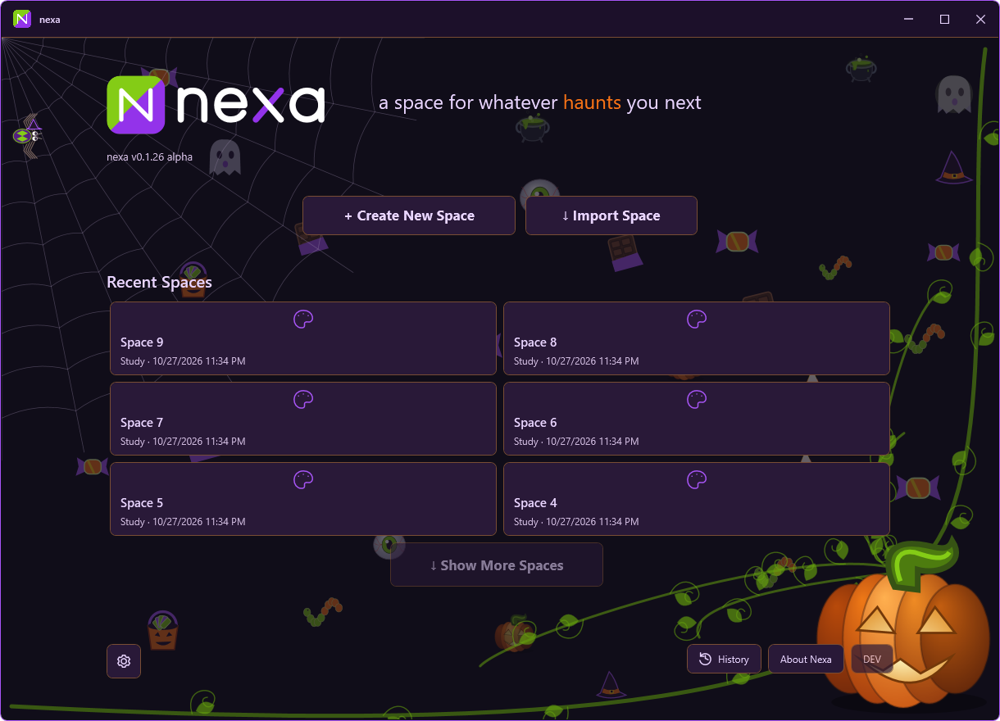
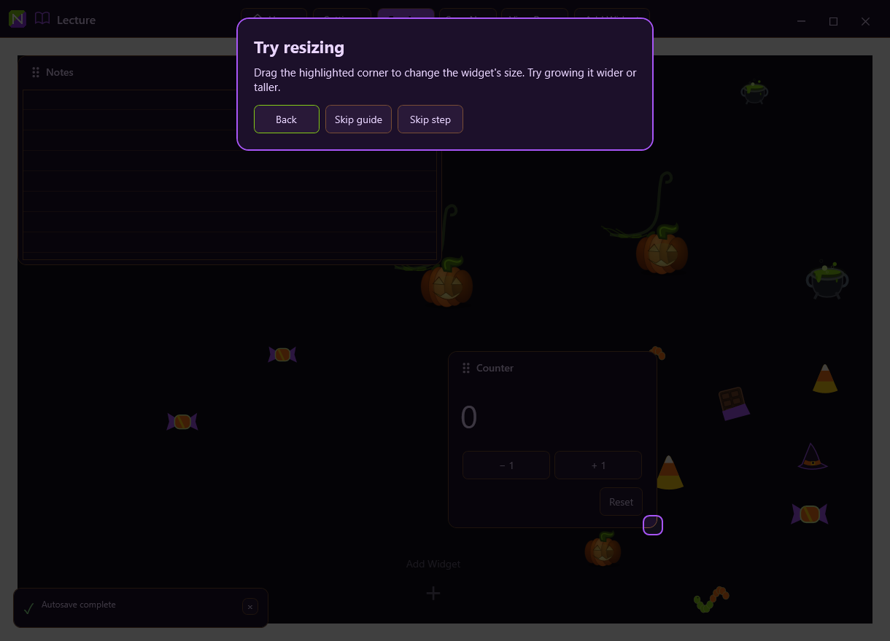
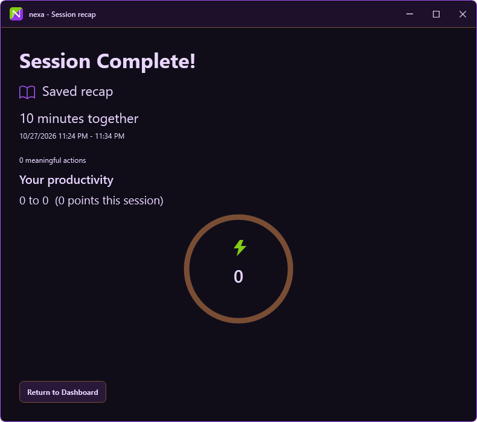
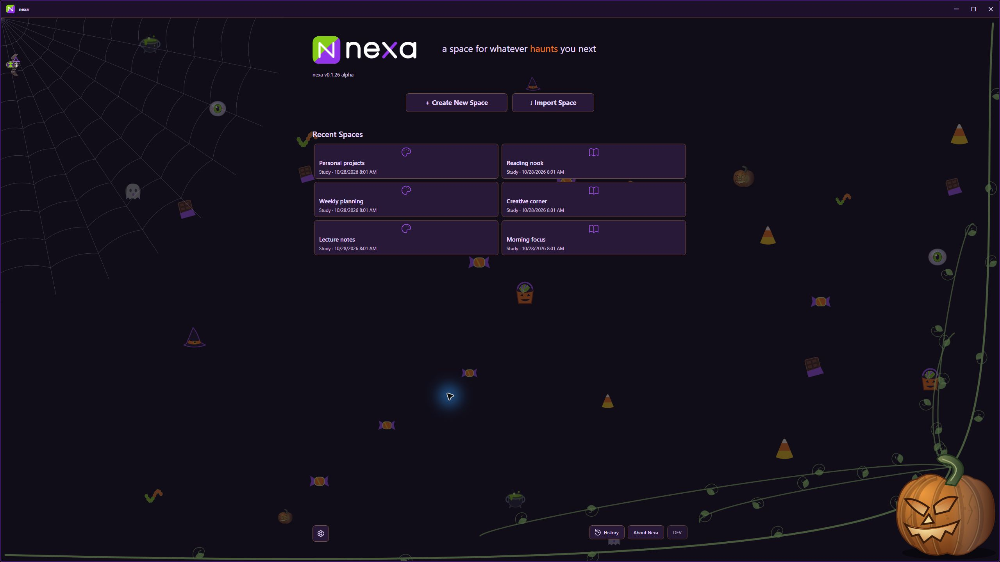

# nexa v0.1.26 alpha - implementation after three passes

Testing candidate on **codex/nexa-026-alpha**. No new version, beta promotion, public release, approved-executable replacement or live-user-data migration was performed. Recovery source: **codex/recovery-before-026-passes** (278bbfe).

## Pass 1 - productivity and session completion

- Persistent per-Space cumulative totals credit each recorded event ID once, including across archives, repeated saves and continued/merged records. Older recorded events initialize the total once; unknown older activity is not invented. New sessions retain their starting total.
- Candy has one base point. The shared streak increments by 0.5 before the current candy award, refreshes for two minutes, and uses the existing configurable cap. Integer bonuses round away from zero (first candy: 1 base + 1 bonus at 1.5x). Direct-squash scoring semantics remain intact. Duplicate claims and candy being eaten cannot score.
- Collection reserves and removes the actual visible candy. A small independent lifecycle timer respawns it even with bugs and seasonal animation disabled. Failed persistence retains pending points and shows the existing save error.
- The Productivity ring animates the cumulative score toward the next 500-point milestone and briefly pulses. View Details retains event/category information. The compact bottom streak popup uses the same cumulative score and multiplier without flames.
- End Session is a dedicated toolbar action. Finalization saves current edits, creates a detached completed candidate, and commits it before showing any recap. Failures retain the current recoverable session. Repeated completion reopens the same recap.
- Early completion has a roughly one-second sequential visual fill, respecting reduced motion. Actual timestamps and scheduled end remain distinct; visual completion does not falsify actual elapsed time or rewrite the class schedule.
- Recaps use saved accomplishments, action counts and cumulative starting/ending scores. Negative changes are preserved. Dashboard/Home navigation retains the completed session; History can reopen saved recaps and older reports omit unavailable recap statistics.
- Missed boundaries preserve the original recorded occurrence. The five-minute review checkpoint and pre-session reset still run safely after recovery.

## Pass 2 - guide, onboarding and settings

- Optional Quick Start spotlights the real Add Widget control, newly added widget, actual resize handle and editable title. Adding, moving, resizing and renaming drive progression through real control paths.
- Back, Skip step, Skip guide, keyboard-focused controls, restart recovery, completed/skipped state and replay from Settings are implemented. The spotlight follows layout/scroll changes, leaves the focused region interactive and places the callout opposite it. Removing the guide restores normal interaction. Periodic tips are suppressed while it is active.
- Onboarding keeps recommendations, offers optional name input, rounded focus-aware fields, animated selection cards, final tool cards, icon selection, a seasonal toggle and independent sound controls. New installations default to Nexaween On; existing preferences remain intact.
- General Settings contains Appearance, Profile, Sounds, Time Zone & Clock, Widgets, Integrations, Updates and Add Bugs. Experimental Features is a bottom expander.
- General Integrations contains Todoist and a separate Hevy connection. Hedy recording notes remain distinct. Future integrations are clearly labeled; existing Google/Microsoft configuration is retained under an advanced expander to preserve prior connections.
- Hevy verifies a read-only workout-count response before storing an API key in the existing Windows-protected vault. This follows the [official public API](https://api.hevyapp.com/docs/) and its published swagger-ui-init.js schema. Real Hevy/Todoist/Hedy accounts were not connected during testing.
- Manual and Schedule Pixel Timer drafts are saved separately. Mode switching restores dates, times and selected weekdays without changing the active timer until Apply. Irrelevant controls collapse and dates use the existing dark control.

## Pass 3 - artwork, transitions and profiling

- Home uses a larger corner web, constrained by available space, with a slowly moving, web-bound spider whose path stays clear of the version label. Static corner artwork is cached; only the spider requires regular redraw.
- Shared pumpkins have a continuous natural silhouette with clipped rib shading, directional highlights, shadows and warm candlelight cutouts. Six varied major vines include two long edge-following branches, irregular curls and leaves.
- Two or three available real widget rectangles receive pumpkins. Vines connect to the selected pumpkin corner and remain in Canvas coordinates during scrolling, moving and resizing. Reserved occupied regions still serve collision avoidance only.
- Mutable resource-brush color/border transitions retain existing bindings. Logos crossfade; decoration visibility fades; reduced-motion preferences bypass animation. Richer purple logo SVG, PNG and ICO variants are synchronized. Normal logo assets are preserved.
- Live web geometry compensates for tall Canvas projection. Restored webs appear with their arriving owners and a short strand reveal, without altering saved construction progress. Existing bounded spatial separation, species behavior, population pacing and quality controls remain.
- Navigation performs one durable worker-thread entry save instead of repeating that checkpoint on the UI thread. A clean Home departure is saved before Home reads it. Input is disabled during the short transition so edits cannot race a detached load; failed navigation restores the source.
- Unnecessary invalidation of every Pixel Timer cell during a theme change is removed. Navigation phase timings are available in memory without logging names, notes or credentials.

## Verification and remaining acceptance

Implementation is complete for the functional subsystems above; physical visual/interaction acceptance remains **REQUIRES MANUAL TESTING**. Automated completion is not a declaration that every physical machine, provider or long-running performance scenario is verified.

See [testing](TESTING-0.1.26-alpha.md) and [release readiness](RELEASE-READINESS-0.1.26-alpha.md). Known performance limitation: a Space-load outlier remains in the measured sample. No live frame-rate or extended-memory improvement is claimed.

## Files changed

- BugOverlay.cs
- DashboardContinuity.cs
- HevyConnection.cs
- HomeWindow.Recent.cs
- HomeWindow.cs
- InterfaceAudio.cs
- MainWindow.Bugs.cs
- MainWindow.ClassSchedule.cs
- MainWindow.Completion.cs
- MainWindow.Continuity.cs
- MainWindow.Feedback.cs
- MainWindow.Navigation.cs
- MainWindow.QuickStart.cs
- MainWindow.Reliability.cs
- MainWindow.Session.cs
- MainWindow.Widgets.cs
- MainWindow.xaml
- MainWindow.xaml.cs
- Models.cs
- NexaLogo.cs
- NexaMotion.cs
- NexaNavigation.cs
- NexaReliability.cs
- NexaSilk.cs
- Nexaween.Animation.cs
- Nexaween.Candy.cs
- Nexaween.Placement.cs
- Nexaween.cs
- OnboardingWindow.cs
- PixelTiming.cs
- ProductivityRing.cs
- ProductivityStreakOverlay.cs
- ReleaseNotes.cs
- SeasonalBackdrop.cs
- SessionCompletion.cs
- SessionHistoryWindow.cs
- SessionRecapWindow.cs
- SettingsDialog.Navigation.cs
- SettingsDialog.Profile.cs
- SettingsDialog.Widgets.cs
- SettingsDialog.cs
- Theme.cs
- assets/nexa-icon-seasonal-256.png
- assets/nexa-icon-seasonal.ico
- assets/nexa-icon-seasonal.svg
- assets/nexa-logo-full-dark-seasonal.svg
- docs/IMPLEMENTATION-0.1.26-alpha.md
- tests/Nexa024Runner.cs
- tests/Nexa026PassChecks.cs
- tests/Nexa026Profiles.cs
- tests/NexaweenMoreChecks.cs
- tests/SessionDashboard.Checks.csproj
- tools/Verify.ps1

## Preview images

These are native WPF renders of the testing source with synthetic data.

Additional report assets: docs/media/preview026/home.png, docs/media/preview026/guide.png and docs/media/preview026/recap.png.

## Pumpkin shape follow-up, October 28

The shared vector pumpkin now has one continuous rounded body. Its ribs are clipped internal shading rather than separate overlapping oval silhouettes. A darker rear flank and asymmetrical carved face preserve the slight leftward turn. The larger Home/menu pumpkin and widget pumpkins share a curved stalk anchor; every main vine begins at that anchor, with earthy greens, curls and leaves. Widget attachment still uses explicit widget targets, collision avoidance remains separate, and decorative art is not hit-testable.

The isolated fullscreen preview route is --home-fullscreen026 in the checks executable. It displays the real Home controls with six synthetic Spaces, fills the primary monitor, and closes with Escape or after ten minutes. It never loads the user's workspace.

